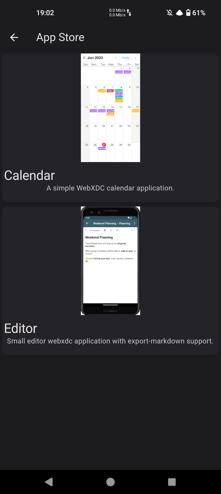
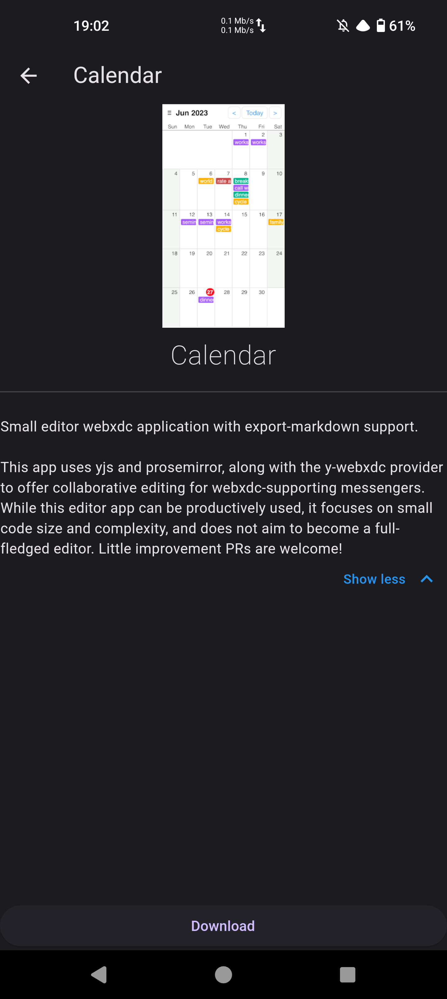
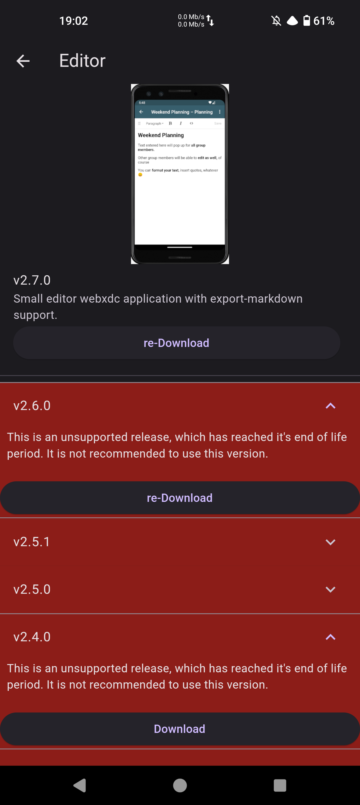

# [2023.12.06] P3pch4t Devlog #2

There are no major milestones achieved but still, there are a couple interesting things that are worth mentioning

## Let's code a bot

Let's start with the most interesting part. How easy/hard will it be to build something on top of p3pch4t? Well, let's build a bot in Golang together.

First, let's create our bot account:

```go
pi := core.OpenPrivateInfo(path.Join(os.Getenv("HOME"), ".config", ".p3pgroup"), "Group Host", "")
```

What happens in this function?

1. We grab some path to store all chat-related data
2. We name our client
3. We provide an optional path (ignore for now, empty is fine)

> NOTE: `core` is more of a low-level package, I do intend to simplify it a bit more, but API will remain pretty similar

Then, let's check if the account is already created, and if not create it (generate private key).

```go
if !pi.IsAccountReady() {
    pi.Create("Group Host", "no@no.no", 4096) // last parameter is key bitsize
}
```


And we are done :), now let's handle some user messages, let's say we want to reply to the message `Ping` with `Pong`

```go
func botMsgHandler(pi *core.PrivateInfoS, ui core.UserInfo, evt *core.Event, msg *core.Message) {
    if msg.Body == "Ping" {
        pi.SendMessage(ui, core.MessageTypeText, "Pong!")
    }
}
```

Great, now let's register the handler.

```go
pi.MessageCallback = append(pi.MessageCallback, botMsgHandler)
```

We are now good to go, but we need to make sure that our go code won't exit too quickly, and actually continue to run. To keep our code simple we can do the following

```go
<-make(chan bool)
```

But... I don't enjoy this way of doing things, so let's throw a proper implementation instead:
```go
c := make(chan os.Signal, 1)
signal.Notify(c, os.Interrupt)
for sig := range c {
    return
}
```

and that's it, that's how it looks exactly in `p3pgroup` now.

I think that the API is pretty straightforward to use.

## p3pgroup

P3pgroup is a Golang server for hosting groups, as I've already mentioned in the previous blog post, groups are basically one-to-one chats that relay messages to all members.

This group server will be a module (that later will be included in p3pch4t), that will allow you to host groups easily, either by running a daemon on some server, by using a hosted solution or by using p3pgroup embedded in p3pch4t. While there are some privacy concerns (group server being able to read all messages) as long as you trust your group operator you are fine

> NOTE: I also plan to make an `encryptFor` optional field when introducing, this way we will encrypt for multiple destinations at once - and we can skip encrypting for group server entirely, but this is not something that is on this or next week's roadmap.

## WebXDC Marketplace

We already have https://webxdc.org/apps/, and awesome `xdcget`, but I didn't like the fact that instead of building .xdc from scratch `xdcget` just downloads the latest `.xdc` from releases. While this is completely fine I do believe that (at least until all security concerns are gone), all .xdc apps should be compiled from source - in the spirit of how the official F-Droid repo works.

WebXDC_marketplace lives on both [git.mrcyjanek.net](https://git.mrcyjanek.net/p3pch4t/webxdc_marketplace) and [github.com](https://github.com/p3pch4t/webxdc_marketplace), prebuilds are hosted on both [static.mrcyjanek.net](https://static.mrcyjanek.net/webxdc/) and [i2p mirror](http://n6hg3o7vh25bftxxqnspfp7li2rh4wkhbqsd65e5sow7hr4gulrq.b32.i2p) which is what app uses to fetch latest apps.

Since there is no official `webxdc` build tool, I've decided that build instructions should be stored in the repository files like this:

```json
{
    "name": "Editor",
    "uniqueId": "org.webxdc.editor",
    "shortDescription": "Small editor webxdc application with export-markdown support.",
    "description": "Small editor webxdc application with export-markdown support.\n\nThis app uses yjs and prosemirror, along with the y-webxdc provider to offer collaborative editing for webxdc-supporting messengers. While this editor app can be productively used, it focuses on small code size and complexity, and does not aim to become a full-fledged editor. Little improvement PRs are welcome!",
    "source": "https://codeberg.org/webxdc/editor.git",
    "banner": "editor.png",
    "supportedReleases": ["v2.7.0"],
    "releases": {
        "v2.7.0": {
            "image": "node:21-bookworm",
            "command": "npm install && npm run build && mv dist-release/editor.xdc /out/app.xdc"
        },
        {...}
    }
}
```

All we need to list the new app is this little metadata file and a .png banner that will be shown to the user in-store. Building it simple

 - Creates a docker container based on the `image` tag in `releases`
 - Clones and checkouts the repo at the given tag
 - Creates a source tarball
 - Runs the build command
 - Moves the resulting .xdc, source tarball, and `banner` to a target directory

```json
{
    "apps": {
        {...},
        "org.webxdc.editor": {
            "name": "Editor",
            "uniqueId": "org.webxdc.editor",
            "shortDescription": "Small editor webxdc application with export-markdown support.",
            "description": "Small editor webxdc application with export-markdown support.\n\nThis app uses yjs and prosemirror, along with the y-webxdc provider to offer collaborative editing for webxdc-supporting messengers. While this editor app can be productively used, it focuses on small code size and complexity, and does not aim to become a full-fledged editor. Little improvement PRs are welcome!",
            "source": "https://codeberg.org/webxdc/editor.git",
            "banner": "org.webxdc.editor/editor.png",
            "supportedReleases": [
                "v2.7.0"
            ],
            "releases": {
                {...},
                "v2.7.0": {
                    "image": "node:21-bookworm",
                    "command": "npm install \u0026\u0026 npm run build \u0026\u0026 mv dist-release/editor.xdc /out/app.xdc",
                    "sourceTarball": "org.webxdc.editor/v2.7.0/org.webxdc.editor.tar.gz",
                    "WebXDCDownload": "org.webxdc.editor/v2.7.0/org.webxdc.editor.xdc",
                    "xdcsha512sum": "b6a51949141ace1b8837bc7eb69ea3174c350c847f378c5ee4ddf68ad96a00dcfad44515df46334b84791a9013a59e642d08f9fb7ca8dcaaa4adfaa9dc8f518e",
                    "tarsha512sum": "7fea8ee5a687f84711f07215eec7191f6a867329686a0b6992dec1731c6975d100b4835e83aa76730479328921a429152bab8a51f6a9852a6e86da9991b79fe2"
                }
            }
        }
    }
}
```
That's it, then the user is provided with a nice `meta.json` file that contains all information about all apps (except for images), so with a tiny caching this is just perfect to run under the pretty unstable i2p network with as high UX as it is reasonably possible. What does it look like? Let me quickly grab .apk from [download mirror](https://static.mrcyjanek.net/p3pch4t/latest/p3pch4t-release/) and show you some screenshots.

|     |     |     |
| --- | --- | --- | 
|  |  |  |

Please note that it isn't *yet* connected to the UI, it just downloads and safely stores the WebXDC, together with metadata. I think that putting installed apps somewhere in the "Files" drawer on the right drawer (or creating another left drawer) would be the way to go. But first, we need some way to configure the chats, to store metadata about apps installed, and this is not something that was on last week's roadmap.

## p3pch4t

Except for the webxdc_marketplace update, [chat app is finally prepared to have multi-user support (this is clickbait, don't waste time on clicking this link)](https://git.mrcyjanek.net/p3pch4t/p3pch4t/commit/21378247539d8439a2fdf83c888be02823acb275). Well not in the UI, but the third argument to the `initStore` function is `path` we will talk more about it later.

[WebXDC JavaScript bug got a fix](https://git.mrcyjanek.net/p3pch4t/p3pch4t/commit/6e7fb2f29d86ae044bff9427411e2980e4f04788) and [store got moved to other directory](https://git.mrcyjanek.net/p3pch4t/p3pch4t/commit/1335a3f53697dbecea613ce313483612ea8f788f).

## p3pgo

P3pch4t now have (theoretical) [multi-account](https://git.mrcyjanek.net/p3pch4t/p3pgo/commit/0e4f111cc37601bc1545994367cb67b0eb9e7257) [support](https://git.mrcyjanek.net/p3pch4t/p3pgo/commit/b52b8c7f8fb0f3f4c3976dbf0d5d1b92c28c4176) 

And files are now served over HTTP instead of being transferred in the `body` of Event [1](https://git.mrcyjanek.net/p3pch4t/p3pgo/commit/198703e85d3f70f52c0113737b97f549cae414e9), [2](https://git.mrcyjanek.net/p3pch4t/p3pgo/commit/4cae20a9dd0f0d03e5dba8e694afae16eea6c8c5). I'm not entirely happy with the implementation and I'll most likely do a little rewrite of it.

Also, [some of the hardcoded values are now configurable](https://git.mrcyjanek.net/p3pch4t/p3pgo/commit/ddae4c992233336c5f2c9ea42c0c9686818d62cc).

## What's the plan?

Next on my roadmap is to work on some of the WebXDC apps, bring WebXDC support to the desktop and other exotic platforms (currently it is only on Android), and add support for Matterbridge, to get some testing done. In a few months from now, I plan to move at least parts of my communication to p3pch4t, either by bridges or by forcing people to use my chat app :p, and by porting the app to all platforms I can find.

Also, the next updates will occur more regularly (assuming that from the first commit to this day almost 10 months have passed).

--------

Project state as of 2023.12.06


Task:
1. Core functionality
    1. [x] Running and configuring embedded i2p router.
    2. [x] Client handshake (Ensuring proper key exchange, showing fingerprint to both users to verify that the contact was properly added).
    3. [ ] ~~Edit the flutter's PGP library to add missing functionality~~ This task no longer applies, we have moved (at least for now) this logic to Golang code
    4. [ ] Event exchange (Ensuring that each event is delivered, grouping events by destination) _Partially done, we do exchange events. I'll consider this step done when the relays arrive_
    5. [ ] ~~Combining all possible events into a Dart library (This includes creating the events and designing how they should look - so we can ensure an efficient and easy-to-implement way of exchanging them.)~~ This step also doesn't apply. But we do have a Golang version of this, still partially WIP.
    6. [ ] Documenting the changes
    7. [ ] Creating an automatized build process to ensure users can make their own versions
    8. [ ] Bot API with libraries for Golang and Python/JavaScript **We are putting it to test right now!**
    9. [ ] Creating a group server in Golang (using the above library) **S00n!**
2. User Interface
    1. [ ] Initial UI release - support all features of the backend library
    2. [ ] UI polishing – including better desktop support.
3. Beta Release
    1. [ ] Android
    2. [ ] Linux
    3. [ ] Windows
    4. [ ] MacOS
    5. [ ] iOS
    6. [ ] SailfishOS???
4. Stable Release
    1. [ ] Fix security issues and bugs
    2. [ ] Release the app on stores
5. WebXDC
    1. [ ] Notes
    2. [ ] Todo
    3. [ ] Calendar (with external sync) _Work started, by [@Im-Beast](https://im-beast.com/)._ 