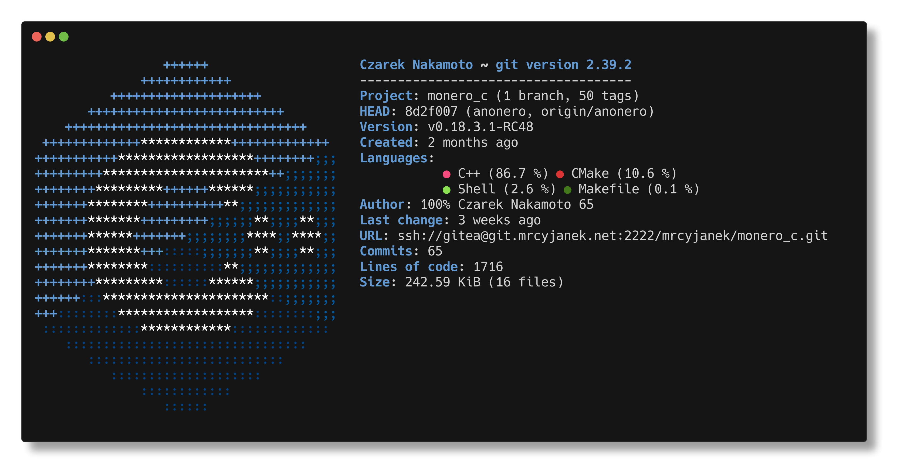
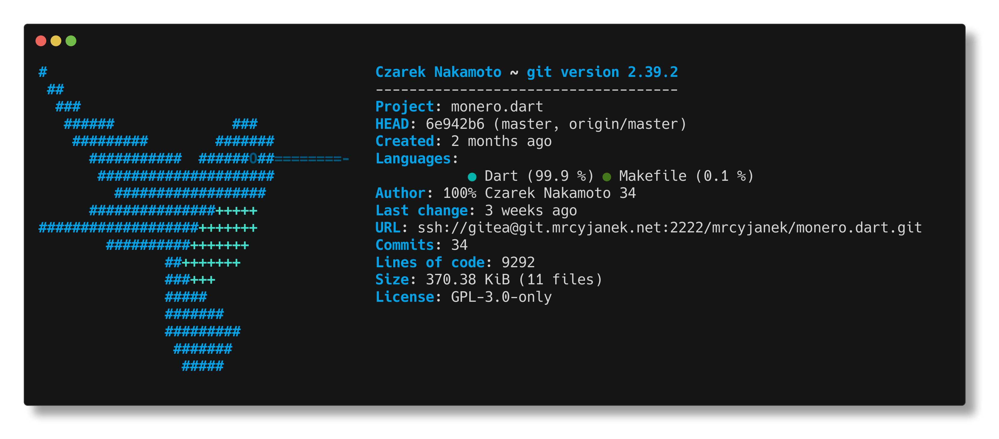
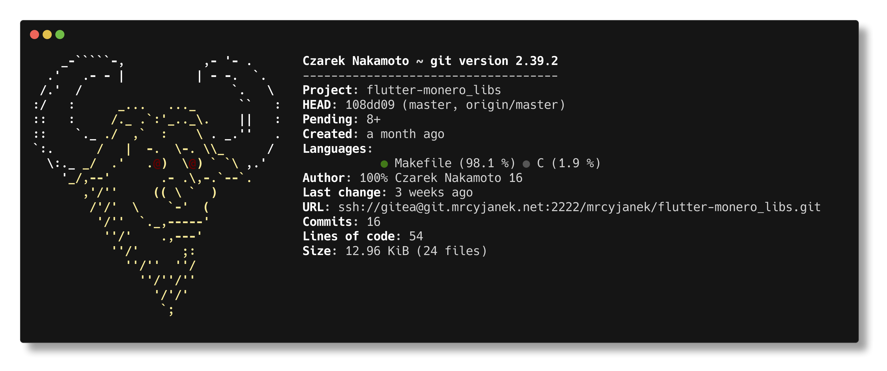
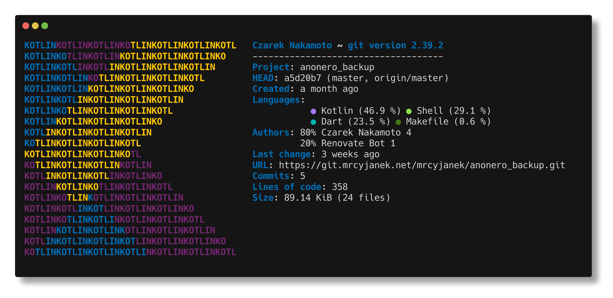
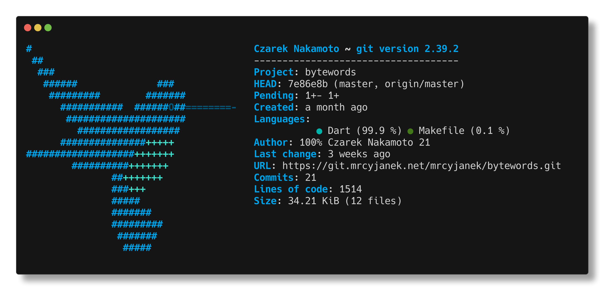
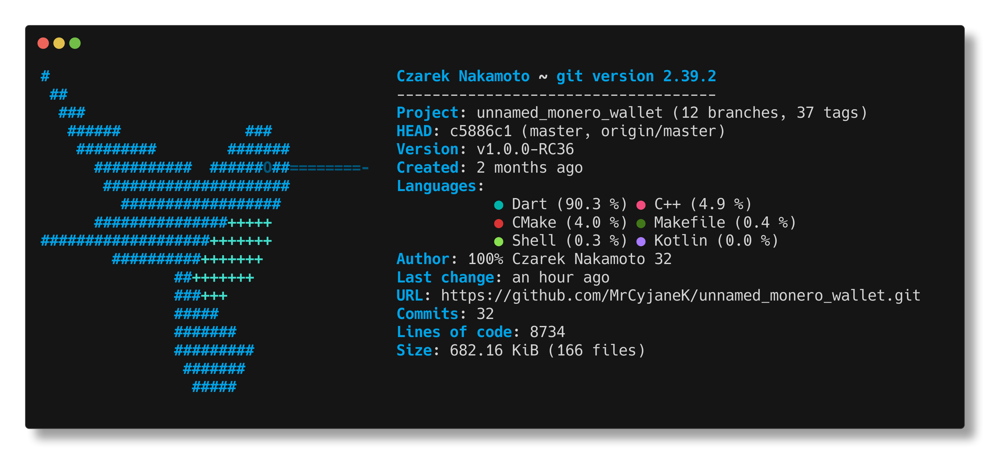
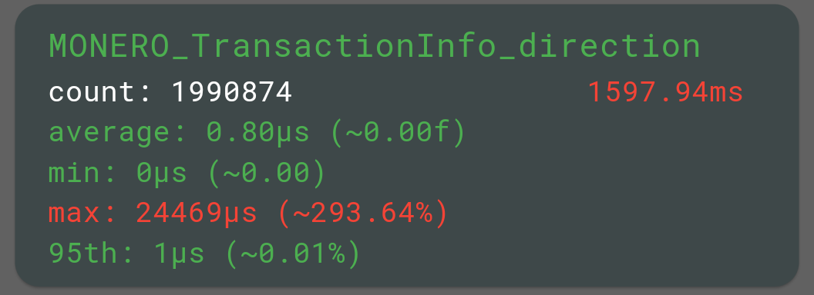
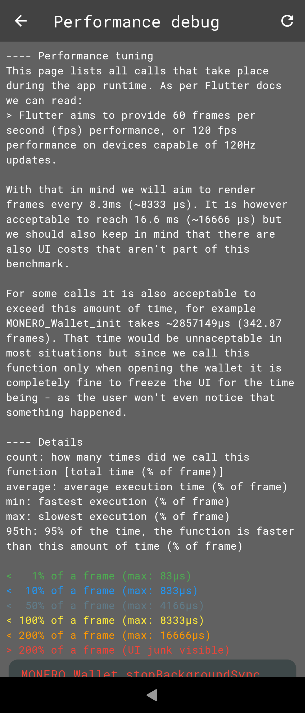
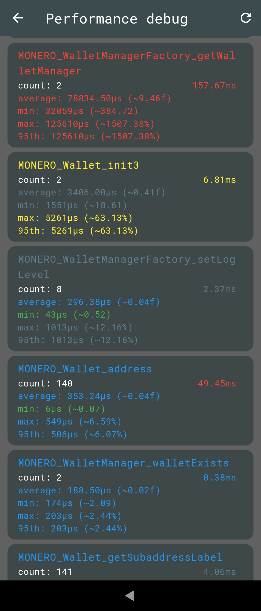
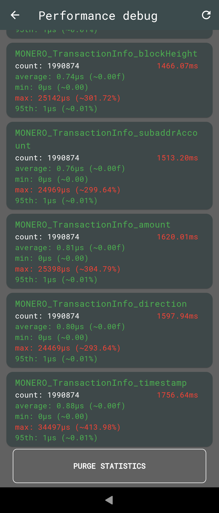

Thousands of lines of code, months of work, a couple of programming languages, failed rewrite... and we have it - a simple, cross-platform, and easy-to-use monero wallet.

> NOTE: This article will be rather technical, so you may want to skip directly to the source code and downloads on [GitHub](https://github.com/MrCyjaneK/unnamed_monero_wallet) or [Gitea](https://git.mrcyjanek.net/mrcyjanek/unnamed_monero_wallet)

# History

This project started as an anonero v1.0 rewrite, which due to a variety of reasons didn't happen. Now this is a sandbox for experiments, which will hopefully end up as a fairly decent wallet.

But I didn't want this project to hang or be fully wasted - so here it is.

# Motivation

You see - there are a couple monero wallets out there - just as there are a couple of Linux distros, one is based on another, some are made for iOS, some for Android, some run on desktop, some forked other wallets, some support monero among 100 of other currencies, some are even closed source, some use Flutter, some use Qt - there is a variety of wallets available currently, so what do you do when we already have enough wallets on the market? [That's right! It's the square hole!](the-square-hole-yt-7haqnQvrYfI.webm)

[](https://xkcd.com/927/)

But no, seriously: I had my reasons, I wasn't entirely happy with current implementations, not that they are bad - they just didn't fit my use case well. You see - xmruw is created entirely from scratch [^1] in Dart/Flutter/C++ and due to the absurd amount of code required to configure Gitea Actions (woodpecker ci is a better option that I'll switch to soon.) you can also add YAML, Dockerfile and bash to the list.

# All Possible Options

Before we dig into our implementation let's see what is on the table currently:

- `wallet2_api.h` -> Official library maintained at the heart of monero-project/monero. Which is used by:
  - [cake](https://github.com/cake-tech/cake_wallet/blob/d6af37df067d49068ce763ea0c1c567eed5d5e74/cw_monero/ios/Classes/monero_api.cpp#L17) which is forked to:
    - [EliteWallet](https://github.com/Elite-Labs/EliteWallet/blob/d0e1a20bc7e6d63d557d1fdf57745625ceeb6bbe/LICENSE.md?plain=1#L8)
    - [StackWallet](https://github.com/cypherstack/stack_wallet/blob/afe43f2a4cf4c4cc2ce766dda4f5ca6ae14ca7e6/pubspec.yaml#L39)
  - [monerujo](https://github.com/m2049r/xmrwallet/blob/0652a8ba143e0cd2e27d11168759498c4239b483/app/src/main/cpp/monerujo.cpp#L19)
    - [anonero (tor)](http://git.anonero5wmhraxqsvzq2ncgptq6gq45qoto6fnkfwughfl4gbt44swad.onion/ANONERO/ANON/src/commit/0c13e0bcb0143f59cacc5cdbeb0d3c56c53cafb2/android/app/src/main/cpp/monerujo.cpp#L19)
    - [mysu (i2p)](http://4hsesnr6mjb4qrflgf5gezjaszzoqnnisin7ywzbsv6pgcxysiaq.b32.i2p/pokkst/mysu/src/commit/44dd9e1d7af86108b473409798971f3d7d3f0fc7/app/src/main/cpp/monerujo.cpp#L19)
  - [feather](https://github.com/feather-wallet/feather/blob/18eea4d1c1ea443fe47f98ee6ed93af62590a7a9/src/model/CoinsModel.h#L7)
- [`simplewallet.cpp` it looks like it doesn't use wallet2_api.h](https://github.com/monero-project/monero/blob/059028a30a8ae9752338a7897329fe8012a310d5/src/simplewallet/simplewallet.cpp)


There are probably some wallets I have skipped (sorry, but launching 3 browsers and connecting to tor, i2p, and convincing GitHub and Cloudflare that I am in fact not a robot is an exhausting task) but you can see the pattern here - `wallet2_api.h` is the main abstraction level provided by upstream and there is monerujo and cake implementation that uses it.

So what you may (rightfully so) think that this is good, we have invented 2 wheels and just reuse them as needed. But is it tho? Let's take a look at that from another side.

## Anonero

Due to privacy and security concerns I and Anonero refused to use cake implementation [reddit](https://np.reddit.com/r/Monero/comments/n9yypd/urgent_action_needed_for_bitcoin_wallets_cake/gxqyscl/) [github](https://github.com/cake-tech/cake_wallet/blob/b67bb0664f7268c31c24bd9fb9cbd438c691f5e3/lib/bitcoin/bitcoin_mnemonic.dart#L11-L22) this resulted in people losing money - while cw_bitcoin and cw_monero are two separate things, and cw_monero doesn't (up to my best knowledge) use any logic on the dart side... this left a bad taste.

Luckily anonero team recognized the issue and opted to use the monerujo implementation instead, and was the first and the only wallet written in Flutter to do so, but this created some issues (according to me and no one else if I had touched more Java and Kotlin in then this most likely wouldn't be a problem).

Let's say that you wanted to display user balance, `wallet2_api.h` exposes a function in the `Monero::Wallet` struct called

```cpp
virtual uint64_t balance(uint32_t accountIndex = 0) const = 0;
```

So assuming we have already loaded the library, and opened the wallet then it should be fairly easy right?... Right? Just `wallet->balance(0);` right?

# CPP, Java, Kotlin, Dart, Async, State Management and Debugging...

Well, technically. But remember that anonero is written in Flutter, and not in Java/Kotlin, and while it is possible to use PlatformChannels this creates a significant issue, now to do `wallet->balance(0);` we need to go through some more steps to get to the `wallet2_api.h` methods. Let's reverse the function call path and see where we go.

## CPP

Let's assume that our root implementation is `wallet2_api.h`, so `Monero::Wallet`'s `balance(0);`. There is nothing fancy about this function it accepts optional `uint32_t` and returns `uint64_t`.

```cpp
// wallet2_api.h

namespace Monero {
    // {...}
    struct Wallet
    {
        // {...}
        virtual uint64_t balance(uint32_t accountIndex = 0) const = 0;
        // {...}
    }
    // {...}
}
```


## CPP<->JAVA

Monerujo is written in Java so the obvious choice for m2049r was to go for JNI, so to get to the function we want we do a trick like this:

```cpp
// monerujo.cpp
// {...}
JNIEXPORT jlong JNICALL
Java_com_m2049r_xmrwallet_model_Wallet_getBalance(JNIEnv *env, jobject instance,
                                                  jint accountIndex) {
    Monero::Wallet *wallet = getHandle<Monero::Wallet>(env, instance);
    return wallet->balance((uint32_t) accountIndex);
}
// {...}
```

And get a read-to-use function that is available in Java.

## Java

```java
// java/com/m2049r/xmrwallet/model/Wallet.java <- note the monerujo.cpp function name
public class Wallet {
    // {...}
    public native long getBalance(int accountIndex);
    // {...}
}
```

This looks straightforward, uint32_t became an int but yeah it is going smooth for now.


## Java(Kotlin)<->Dart

> NOTE: Anonero didn't actually call the getBalance function this way, it used a listener instead (which is a better approach), but for simplicity, I'll present code that would have been used if we used normal calls, the function we are calling this way is `viewOnlyBalance` which has a similar signature but does a different thing - for our purpose it is the same thing. I'll continue to call it getBalance to not cause confusion. If you want to search the source code for the implementation use the function name I have above.

We are in Kotlin now, we will be calling Java code, however. It doesn't matter as they both are compatible.

```java
// WalletMethodChannel.kt
class WalletMethodChannel(messenger: BinaryMessenger, lifecycle: Lifecycle, private val activity: MainActivity) : AnonMethodChannel(messenger, CHANNEL_NAME, lifecycle) {

    init {
        // {...}
    }

    override fun onMethodCall(call: MethodCall, result: Result) {
        when (call.method) {
            // {...}
            "getBalance" -> getBalance(call, result)
            // {...}
        }
    }

    private fun getBalance(call: MethodCall, result: Result) {
        scope.launch {
            withContext(Dispatchers.IO) {
                result.success(WalletManager.getInstance().wallet.getBalance())
            }
        }
    }
    // {...}
}
```

umm.. this is actually pretty verbose, but if you don't mind the boilerplate code that is copied over you now should have the function available in the next language...

## Dart

The dart side of things looks similar - also a class and a few methods.

```dart
// wallet_channel.dart
class WalletChannel {
    static const platform = MethodChannel('wallet.channel');
    // {...}
    Future<int> getBalance() async {
        return await platform.invokeMethod("getBalance", {});
    }
}
```

So we are ready? Can we build the app finally?

You wish. Didn't you notice that? Don't you see that little detail?

## Async

If not for the `async` nature of platform channels we would be ready to go. If not the async nature we could do something like this:

```dart
class MyWidget extends StatelessWidget {
    const MyWidget({Key? key}) : super(key: key);

    final balance = WalletChannel().getBalance();

    @override
    Widget build(BuildContext context) {
        return Text(balance.toString());
    }
}
```

async version:

```dart
class MyWidget extends StatelessWidget {
    const MyWidget({Key? key}) : super(key: key);

    final balance = WalletChannel().getBalance();

    @override
    Widget build(BuildContext context) {
        return Text(FutureBuilder<String>(
            future: balance,
            builder: (BuildContext context, AsyncSnapshot<String> snapshot) {
                if (!snapshot.hasData) {
                    return "?.????????";
                }
                return snapshot.data
            }
        ));
    }
}
```

But we have async. And we can't use that. we can use FutureBuilder instead but this combined with the number of calls that are happening, and delays added by PlatformChannel would cause things like:
- Blinking UI (placeholders loading for a frame or few)
- Hard to read and maintain code (wrapping even the simplest things in FutureBuilders)

since this blog post is supposed to be about xmruw and not anonero (technically xmruw is a failed rewrite of anonero), let's highlight the last thing

## Async performance wise

This is by no means a good benchmark. It is a script I have written in Dartpad and ran locally to confirm that it also makes a difference outside of the browser. But you can see where it is going.

| Iterations |    async   |   future    |   sync    |
| ---------- | ---------- | ----------- | --------- |
| 1'000      | 0.15171ms  | 0.34523ms   | 0.00116ms |
| 1'000'000  | 79.10659ms | 201.59368ms | 0.96132ms |

[Code of the benchmark](dart_async.dart.txt)

So as can be seen in this not-so-complicated benchmark there is a huge (proportional) cost to using async code. This benchmark didn't take JNI or do any kind of actual processing on the function side. Just pure async / future/sync functions returning `1`.

So it may be a good idea to switch to blocking code for the UI.. which is a strange thing to say but we have three options left now

- Hold the UI manually (effectively making async code blocking, just in a _proper_ way)
- Use FutureBuilders, which for calls that take longer than 1/120s (8.3ms) will cause the frame to render a placeholder and then replace it with something else causing a weird blink.
- Call blocking functions directly. Will the end user notice the fact that the app was frozen for 1 frame? And even if the user will in fact notice that there are not many calls that actually do block for a long amount of time. And even if we do need to call them we can spawn another isolate which will run code without blocking the UI.

> NOTE: Anonero used state management which solved the issue but has added a very react-like feel to the source code, so it solved the issue but introduced a DX drawback.

## Debugging

Let's sum the layers of abstraction:

0. [CPP] `wallet2_api.h`
1. [CPP<->Java JNI] `monerujo.cpp`
2. [Java] `Wallet.java`
3. [Java(Kotlin)<->Dart PlatformChannel] `WalletMethodChannel.kt`
4. [Dart] `wallet_channel.dart`
5. [Flutter] wrapping async code...

note that none of this code was generated, everything was written, and doing things like type mismatch, or a wrong variable name passed via PlatformChannel will result in a catastrophic event where everything breaks and you have to figure out which layer is a faulty one. You don't get any IDE suggestions for what functions are available. And anonero has cutting-edge features in it, many patches applied on top of `monero-project/monero`, which made development harder when we were applying new features - because if something doesn't work how do you know if it is: wrong text encoding? type mismatch? a simple typo in an object? not using the latest compiled binary?

There was a need for the...

# Rewrite

The goal was to simplify the codebase, it did happen but a few things couldn't be easily brought back, and releasing a rewrite with less (important) features couldn't happen. But the side product remained, and we have xmruw now.

## monero_c



> [GitHub](https://github.com/mrcyjanek/monero_c) [Gitea](https://git.mrcyjanek.net/mrcyjanek/monero_c)

The first goal of mine was to get rid of as many layers of abstraction as possible, the big elephant in the room was the fact that all flutter-based wallets appeared to ignore the existence of `dart:ffi` and used the JNI. Why did they opt to call functions using Java instead of `dart:ffi`? Initially, I thought that there were no drawbacks to using it (spoiler alert: there are plenty).

First of all `dart:ffi` doesn't support C++, so for this reason I had to write `monero_c` which wraps the C++ calls into a C header file. It contains many code blocks similar to this one:

```cpp
uint64_t MONERO_TransactionInfo_blockHeight(void* txInfo_ptr) {
    Monero::TransactionInfo *txInfo = reinterpret_cast<Monero::TransactionInfo*>(txInfo_ptr);
    return txInfo->blockHeight();
}
```

In fact - it contains almost every single function (even more complex ones, that use `std::vector`).

I have also compiled it for Android, and Linux (alpine soon) on CI so it is trivial to start using it.

> Fun fact: initially I asked some people on Fiverr and Upwork to do the wrapper for me because I didn't want to write C++ code (I have zero experience in it). But after getting hit with poor-quality, often AI-generated work I've just gone ahead and written that on my own (by forking some code from monerujo, most notably cmake configuration).

## monero.dart



> [GitHub](https://github.com/mrcyjanek/monero.dart) [Gitea](https://git.mrcyjanek.net/mrcyjanek/monero.dart)

So the natural next step was to use the awesome `ffi_gen` package to generate Dart code from the `wallet2_api_c.h` (monero_c) (I didn't handwrite those 9k lines of code.. but I did some.)

Sadly, for reasons unknown to me ffi_gen doesn't provide usable functions (at least usable in my opinion) so I had to write a wrapper around them.

```dart
int MONERO_Wallet_balance(MONERO_wallet ptr, {required int accountIndex}) {
  debugStart?.call('MONERO_Wallet_balance');
  lib ??= MoneroC(DynamicLibrary.open(libPath));
  final balance = lib!.MONERO_Wallet_balance(ptr, accountIndex);
  debugEnd?.call('MONERO_Wallet_balance');
  return balance;
}
```

I've also added the `debugStart` and `debugEnd` functions which came **really** handy when we had some performance issues. But this example doesn't really show what kind of code I had to write manually (more than 3000 lines of that...). You see numbers are simple (I know, little endian, big endian, I know. I am aware, but in general when we invite strings into the conversation.. things take a nasty turn.)

```dart
String MONERO_Wallet_genPaymentId() {
  debugStart?.call('MONERO_Wallet_genPaymentId');
  lib ??= MoneroC(DynamicLibrary.open(libPath));
  try {
    final displayAmount =
        lib!.MONERO_Wallet_genPaymentId().cast<Utf8>().toDartString();
    debugEnd?.call('MONERO_Wallet_genPaymentId');
    return displayAmount;
  } catch (e) {
    errorHandler?.call('MONERO_Wallet_genPaymentId', e);
    debugEnd?.call('MONERO_Wallet_genPaymentId');
    return "";
  }
}
```

Not only do we need to cast `ffi.Char` to `ffi.Utf8`, but we also need to call `.toDartString()`... and guess what? Not all strings are `Utf8` so we need to `catch` any potential errors (or we risk crashing the main isolate (for non-dart devs: main thread crash)).

But this isn't the worst-case scenario. It's getting even funnier.

```dart
bool MONERO_Wallet_paymentIdValid(String paymentId) {
  debugStart?.call('MONERO_Wallet_paymentIdValid');
  lib ??= MoneroC(DynamicLibrary.open(libPath));
  final paymentId_ = paymentId.toNativeUtf8().cast<Char>();
  final s = lib!.MONERO_Wallet_paymentIdValid(paymentId_);
  calloc.free(paymentId_);
  debugEnd?.call('MONERO_Wallet_paymentIdValid');
  return s;
}
```

Here we need to `.toNativeUtf8()` and cast it to `ffi.Char` because what the heck is `ffi.Utf8`? Not only that but I also need to manage my own memory (dart is garbage collected) because why not? And I get why it is done this way even in the scope of `monero-project/monero` std::string is used to carry arbitrary data - but still it would be nice to have something generate that code for me. But anyway, it's written so I no longer care that much.

## flutter-monero_libs



> [GitHub](https://github.com/mrcyjanek/flutter-monero_libs) [Gitea](https://git.mrcyjanek.net/mrcyjanek/flutter-monero_libs)

We need some way to bring the `libwallet2_api_c.so` into the proper location on Android (and possibly on Linux and other desktop operating systems too but I have not done that because I am afraid of writing more cmake).

> Note: up to my best knowledge we actually don't have to do it, we can load .so without executable permissions so we can
> 
> - download it
> - keep it compressed and uncompress it on the first run
> - potentially allow beta-testing of new versions of the library without updating the app.
> 
> But Google has implemented W^X protection that I have to comply with to get my app to Google Play, and it would be very not-nice to violate the policy that broke Termux (broke the useful legit use while keeping the malicious use intact)

## anonero_backup



> [GitHub](https://github.com/mrcyjanek/anonero_backup) [Gitea](https://git.mrcyjanek.net/mrcyjanek/anonero_backup)

Since this started as a rewrite of anonero I had to implement a backup/restore mechanism that is compatible with the v0 version of anonero. I've decided to put all cryptographic functions into a separate repository to avoid rewriting cryptographic functions from scratch and to make sure it is 100% compatible. This way I have also managed to not put any Kotlin/Java code inside of the main project repository and I have left the core functions intact.

## bytewords



> [GitHub](https://github.com/mrcyjanek/bytewords) [Gitea](https://git.mrcyjanek.net/mrcyjanek/bytewords)

Bytewords ([BlockchainCommons/Research/papers/bcr-2020-012-bytewords.md](https://github.com/BlockchainCommons/Research/blob/master/papers/bcr-2020-012-bytewords.md)) also got implemented in a separate package because it may be useful to other wallets (and possibly other projects using UR).

This package also needs some extra testing so it makes sense to separate it from the core codebase.


## unnamed_monero_wallet



> [GitHub](https://github.com/mrcyjanek/unnamed_monero_wallet) [Gitea](https://git.mrcyjanek.net/mrcyjanek/unnamed_monero_wallet)

**FINALLY** Once we have everything in place we can put up the wallet into one large piece. I have focused strongly on the code to be simple to add new features, I have made it portable (it runs on Linux and Android), and focused strongly on debugging.

Now to toss in a new feature[^2] all we need to do is to create a monero_c update (which is really just a bit of boilerplate around the C++ code), and run the code generator that is configured in monero.dart repository and we are ready to use it in our wallet.

0. [CPP] `wallet2_api.h` <- unavoidable
1. [CPP<->C] `monero_c (libbridge)` <- avoidable if monero-project/monero would provide C headers.
2. [Dart] `monero.dart` <- unavoidable

Now we are only one extra step away from the upstream, and due to the nature of `ffigen` we get full LSP support and IDE integration - if something is semantically broken it won't compile.

Also, the code is blocking by default - this may cause some UI lags, but thanks to the performance debug screen we can easily spot which function is causing the issue and make it async by throwing it into an isolate.

As a bonus I have also entirely got rid of any state management - everything is a call to native monero function. Why? Because it is so damn fast.



This function is (intentionally) called **much** more frequently than it is needed, it is called for every transaction in the wallet, and it takes 0.80µs on average to process the call.

> NOTE: I am aware of the large **max:** value, this function is called instantly after the wallet opens/unlocks (exists background sync mode) so my guess is that it is sitting on some mutex, as once the wallet is opened it doesn't take that much time to call.

These kinds of logs are stored for every single function call, so if something goes wrong and the app lags - we know why, if some function crashes - we know which one [^3].

| screen 1 | screen 2 | screen 3 |
| -------- | -------- | -------- |
|  |  |  |


There are still some rough corners around the apps, and some random crashes occur from time to time, but with UI being one extra step away from the upstream codebase I'm pretty sure that we can do a very rapid development.

> If you like the idea feel free to test the wallet, leave a star, join chatrooms, or donate. [All links can be found in the README.md](https://github.com/mrcyjanek/unnamed_monero_wallet?tab=readme-ov-file#unnamed_monero_wallet)


[^1]: It does use monero-project/monero with some patches applied (anonero.io's fork). Other than that - it is developed from scratch.

[^2]: Feature as in something that changes `wallet2_api.h`.

[^3]: **Technically** code for that is soon to be implemented.