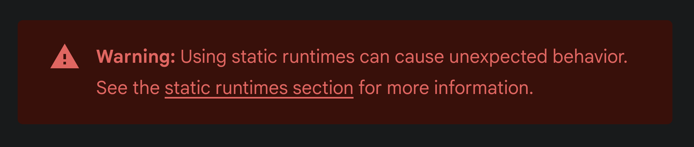
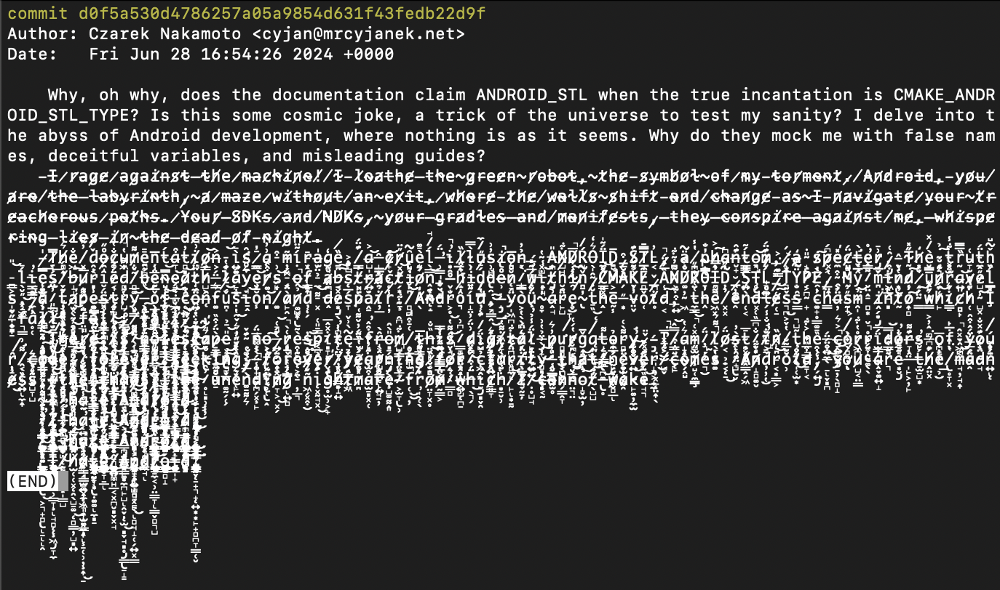

> NOTE: This article was published on 18/05/2025.

Time has flown almost instantly, one minute I was working on one wallet, and in the blink of an eye, I'm working on Stack
Wallet and Cake Wallet to bring Monero and Wownero support, then my CCS got accepted, and now I work full time at Cake
Labs.

So what exactly happened? Let's begin at the beginning of the story... Or no, let's be random, let's start with
non-monero stuff and monero stuff later.

## About FOSS

If you compare me to myself from 2 years ago, you will notice a slight difference. Let's make a table about that.

| x              | 2 years ago                | At the time of writing | At the time of publishing |
|----------------|----------------------------|------------------------|---------------------------|
| Dev machine    | Lenovo Legion              | MacBook                | MacBook                   |
| Dev OS         | QubesOS                    | macOS                  | macOS (and linux)         |
| IDE            | VSCodium                   | Android Studio         | VSCode / Cursor           |
| Main phone     | Xperia 10 III              | iPhone                 | iPhone                    |
| Main phone OS  | SailfihsOS                 | iOS                    | iOS                       |
| Dev phone      | OnePlus 9 Pro (android)    | My main phone          | Pixel 9 with Graphene     |
| Source control | Self hosted Gitea          | GitHub                 | GitHub and ~/Documents    |
| CI/CD          | Gitea Runners (selfhosted) | Github Actions         | GitHub Actions (selfhosted worker) |
| CI/CD          | woodpecker (selfhosted)    |                        |                           |
| CI/CD          | jenkins (selfhosted)       |                        |                           |
| Work chat app  | Mattermost                 | Slack                  | Slack                     |

As you can probably see, that's quite a shift from "Selfhost everything", use FOSS software, put everything in a VM, and
daily use a XEN distribution to using a MacBook and hosted services? Yes. I did. After 9 years of using Linux (yeah, Qubes
is not Linux, but you get the point.) I've moved my main OS one more time, to a closed source imitation of Linux..?

Yes. While I'm happy that I've grown up using Linux, now that I understand how computers work.. I don't want to daily it
on my desktop, because there is always _something_ to do, sometehing that breaks, something that is unsupported, some
weird dependency that takes just 10 minutes to get right, now add another 15 to fix gitea runner, 5 to maintain
mattermost, 10 more to fix dependencies on my SailfishOS device (just few more minutes to get flutter running on that
thing), and suddently I had to spend more than 30 minutes every single day just to do basic stuff. Not to mention the
fact that Windows blew up by itself because of Windows Updates eating my Linux boot partition and forcing me to do a
reinstall. Just two weekends that I had to spend on "preparing to work" were enough for me to switch gears and
stop wasting time on things that should be working. The same goes for my IDE of choice, it helps me without getting too much
in the way, and I'm happy. Now my computers and my servers work for me, instead of me working for them. Even 15 minutes
a day is worth changing the software I use.

## Windows support

### POSIX you say?

MoneroC got Windows support that **doesn't** crash whenever you try to use it (yeah.). It was a really fun journey, that
ended around the free() call. When using mingw64 toolchain to compile `libwallet2_api_c.dll`, it used POSIX style
allocator, which is nice. But when we were using that library to work in Flutter (and fixing a memory leak. Oopsie.), it
got built with MSVC toolchain, which uses whatever Microsoft decides, which should be fine?

> The UCRT also implements a large subset of the POSIX.1 (ISO/IEC 9945-1:1996, the POSIX System Application Program
> Interface) C library. However, it's not fully conformant to any specific POSIX standard.
>
> [learn.microsoft.com](https://learn.microsoft.com/en-us/cpp/c-runtime-library/compatibility)

They say that **yeah** it implements POSIX, but not the POSIX that you know and enjoy, it just uses the same name
function name and scheme, but it is entirely different in the implementation.

So what does it mean? Long story short - calling `free()` from MSVC on `malloc()` from POSIX crashes the app.

Windows also needed some workarounds to export DLL functions - but for the most part it was just an easy fix... Well
more like easy couple fixes.

## Android support

### ANDROID_STL

First of all, Android is such a... wonderful platform to work on, and ANDROID_STL is my favorite part of that ^^.

But why exactly is that bad? Let's picture this that way, most popular systems have some kind of system library, on macOS
it is `libSystem.dylib`, on Linux it gets a little bit more complicated `libc.so` is either GLIBC (on most devices) or
musl, for hardcore Linux users. On Windows, a more common way is to link against `kernel32.dll`.

Okay, cool, but what do we do on Android? According
to [android docs](https://developer.android.com/ndk/guides/cpp-support), there are 3 ways that we can go with.

#### none (no headers, limited C++)

> There is also the option to have no STL. There are no linking or licensing requirements in that case. No C++ standard
> headers are available.

Awesome, no comment on that one. We kind of need the C++ STL. What's the other option?

#### System

This provides us with `new` and `delete`, however monero code expects slightly more, and even if that would be enough it
got deprecated in NDK r18

#### libc++

Okay this should be good, there were 3 options, one is none at all, one got deprecated, this should leave us with a
fairly obvious option, Android comes with a standard library that we can use, a library that we can use, and guessing by
the name (libc++) and android description (modern C++ support) it should be as easy just loading the library and using
it right away. Right? Right?

Let's take a few steps back, where exactly is that library - for the system, one of the paths that exist and looks like STL was `/system/lib/libstdc++.so`, but that one is just the `new` and `delete` STL.
There is no `libc++_shared.so` anywhere in the system paths. Does it mean that we have to ship our .so? This is weird, but I can do that.

Except you can't do that. To use it you need to have correct version of libc++_shared.so in your libs
directory, and you can't have multiple standard libraries in one APK, so if one of your dependencies happen to require
libc++ from ndk r19 and one from r25 you are screwed. But how am I screwed? In the **worst** possible way - crashing at
runtime. Your app will love to call a native function in the standard library that is just not there, and no - you can't
solve that "GLIBC style", by compiling the app with an old toolchain and shipping newest .so, as none of this crap is
backwards compatible.

Okay, so what are our options? This nice red warning notifies about the dangers of doing exactly that.

Let's see the dangers of [using static runtime](https://developer.android.com/ndk/guides/cpp-support#static_runtimes)

> If all of your application's native code is contained in a single shared library, we recommend using the static
> runtime. This allows the linker to inline and prune as much unused code as possible, leading to the most optimized and
> smallest application possible. **It also avoids PackageManager and dynamic linker bugs in old versions of Android that
make handling multiple shared libraries difficult and error-prone.**.

Well, that's good, that's what I want, but the link indicates that there is a problem with using static libraries; this is
a benefit (and a benefit I would like to have). Let's carry on reading the article.

> That said, in C++, it is not safe to define more than one copy of the same function or object in a single program.
> This is one aspect of the One Definition Rule present in the C++ standard.

Ah, that's what you mean. So I can't link multiple STLs in a single program (assuming the program is a library or actual
binary, not an entire app). So I guess this should be good, and as far as the implementation in xmruw, Stack Wallet, and
Cake Wallet goes there hasn't had a single reported of app crashing because of invalid statically linked STL. That's
good. That's what I want.

> 18/05/2025 - No crashes related to this, still, it was a good choice to ignore the big red box.

This is the end of the STL story. Especially because the documentation was very different from what was needed to
get it working, as can be seen in this completely sane commit message.

This sucks, especially because this task should be so easy that it is crazy how many hops I had to jump on to get it right, that it is insane. I don't understand two things.

- Why can't we have a system-wide, backwards compatible version ot STL?
- Why doesn't it default to static linking? The issues are the same when you redefine a symbol in a shared and static
 library, with one small difference, loading that library dynamically crashes on runtime, which is to a huge extent
 worse than crashing at compile time...

## Monero code fixes

### Bytecode and URQR

[As per the spec](https://github.com/BlockchainCommons/Research/blob/master/papers/bcr-2020-012-bytewords.md) bytewords
have the same capability as hex strings, but are easier to transfer and read as a human. Instead of a string looking like
this `c7098580125e2ab0981253468b2dbc52feac0dea`, it would be `staslplabghydrpfmkbggufgludprfgmzepsbtwd` (or
`slot-axis-limp-lava-brag-holy-door-puff-monk-brag-guru-frog-luau-drop-roof-grim-zone-plus-belt-wand` if you use the
full version). Now that I think about it, ease for humans is not a very strong point, but okay.

Okay, but what do we need that for? Simply put, we need to send a couple of kilobytes (maybe 100KB, maybe less, maybe more),
but transferring the data over a single QR code, so we need to animate them and display them one after another. How does
that work?



> NOTE: Scanning performance is much better on Android, but more on that later.

So with that in mind, we needed a way to transfer large data via QR codes, and URQR works just fine, as it contains
everything we need

- part id
- scheme (type) of what we transfer
- checksum

Joining everything together is a matter of scanning the codes, doing some strings, converting that to bytes, and doing a
CBOR decode and viola, we have data and metadata about the transfer. However, I didn't want to implement that from
scratch. Well, I did. Twice. One time it didn't work, and the other time it wasn't compatible with existing
implementations, so I went straight to the feather-wallet source code, looked at their dependencies, found bc-ur, and
added that to monero. Sounds easy enough, but I had to bump the version of C++ that monero uses, which required me to
fight with that developer-hostile environment called Android. Do you remember the STL part? Yeah. I had to fight with
that one more time, and when I did, the STL broke ONE MORE TIME. This was a very unpleasant experience for me.

But after that was done, and UR encoding got migrated to the monero codebase, we got the benefit of not writing the data to
disk. Up to this point, UR encoding was handled after encoding a transaction and writing it to disk, now it is done
entirely in memory, leaving no trace on disk about this transaction whatsoever.

Nice. This is a huge win, we are in memory, and compatible with the Feather wallet. Goal achieved.

### Store

Did you know that while casually calling `wallet2::store()`, you can not only crash the wallet but also corrupt the
wallet cache file? Yeah, this isn't ideal - to overcome this monero-gui stores the wallet once every 10-15 minutes,
which decreases the chances of corrupting the wallet when compared to storing the wallet every 10 seconds, or Feather
wallet allows storing only after you have fully synced the wallet.

While these workarounds work, they are far from ideal. Especially in the mobile market, when randomly exiting an app is a
rather common thing to do, and in the case of monero, having to sync from scratch just because you closed your wallet is
not ideal. Also, the option to lose up to 10 minutes of sync (while still risking corrupting the wallet) is not good as
well.

To overcome that, I've patched the store() function to pause the sync before storing, and start it after the wallet is
stored. During my testing, I was able to store the wallet over 100'000 times, and after that point, my performance logger
OOMed, but I counted that as a win, especially when we take into account the fact that without the patch I couldn't
reach the 10'000 mark.

One thing to note - this didn't come without its problems - it slightly increased sync times, but it was worth it.

> 18/05/2025 End of this article. I planned on finishing this post, but due to events outside of my control
> I wasn't able to.