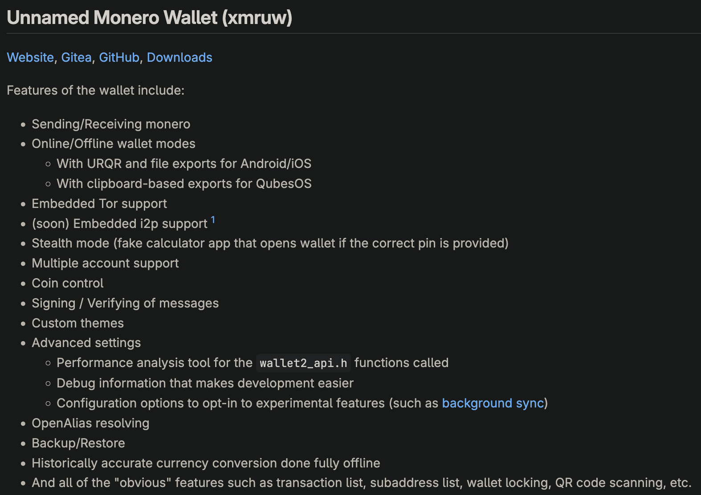

> If you haven't seen [MoneroC eight months later](/p/moneroc-eight-months-later/) you may want to read it before proceeding

Okay, let's lay everything down, this post will be a summary of

- Everything that is related to CCS milestones
- Some fun things that happened along the way
- Future of monero_c

But to make things more interesting, everything will be written at random, and sorted solely through my gut feeling about whether
something was worth writing about or not.

Let's start at the beginning. Or no,[I've already done that](/p/xmruw-monero-wallet/), let's start roughly around a year ago.
In my CCS description, I've mentioned the following features.

all of these existed way before the CCS got merged, and continue to exist up to this day, we won't be discussing these, and to
be fair, we won't be discussing xmruw too much, but we will be discussing monero_c and all work on xmruw that resulted in several
great packages, so let's start!

# Scope of work

## Compatibility

The first goal of my CCS was as follows.

> Expanding compatibility of monero_c to all platforms that I have access to (Linux (glibc+musl), FreeBSD, iOS, MacOS, Windows) in an easily reproducible way (single script and a Docker environment)

And.. did I do that? Sort of.

### Linux

Linux is fully supported on 2 major CPU architectures with both 32-bit and 64-bit configurations.

Monero_c has been tested on both normal, "mainstream" distributions such as Debian, Ubuntu, Fedora, Arch, and those niche ones that I use personally - SailfishOS. I pay extra attention to any reports that could indicate that something broke in monero_c on Linux, and I fix it right away (and that's the reason for which I have 7 desktop distributions on my Proxmox server). Many hours have been spent on debugging niche issues, including the most recent [executable stack](https://aur.archlinux.org/packages/cake-wallet-bin#comment-1016815) issue reported on AUR.

As for musl systems, support has been there, but since nobody ever used it, and it was a significant maintenance burden for no real benefit support has been dropped. Even if monero_c would still support musl realistically all users of software that use monero_c would run it in GLIBC mode via for example distrobox because none of the software that uses monero_c supports alpine (at least none that I'm aware of).

### FreeBSD

It is not supported, I don't use it, and I don't know of anybody who is using FreeBSD let alone anyone who would need monero_c on it. If that changes I'll be very happy to offer support.

### Windows

For the most part, Windows support is very painless to maintain; it didn't require any changes, and I got it right, and nobody ever reported an issue with it. It is currently cross-compiled from Linux using the mingw toolchain, with support for only the x86 architecture. WoA support didn't arrive natively yet because I'm patiently waiting for [mingw-woarm64-build](https://github.com/Windows-on-ARM-Experiments/mingw-woarm64-build) to be fully upstreamed or at least with 100% compatibility, especially because Windows has no issue loading x64 DLL on WoA systems.

### macOS

MacOS has probably lived through the most changes in the entire build system of monero_c.

Initially Darwin was cross compiled from linux, which worked great, but not for people over at Cake Labs (back before I started working at Cake and way before I've switched to macOS as my daily machine), because cross compiling toolchain that monero uses assumes x64 machine that runs linux, and rosetta while much better than WoA translation layer kept segfaulting at random points during the build inside of Docker. So I had to ship something that would make it possible to build Darwin builds on Darwin.

That's why I've decided to depend on brew packages for dependencies when building development builds of monero_c on mac, which worked great until everything started to break with random updates, so the way forward was clear - we had to either drop support for macOS native builds or reuse current build system.

Monero's fork of Bitcoin's `contrib/depends` system doesn't care about being portable; it works great for cross-compiling, but it didn't work when you wanted to run the build process on other platforms. In the meantime, monero_c gained support for wownero and zano, which are based on monero's source code.

Up to this point, I've simply used the monero/wownero build system with slight patches to introduce new features, but now this meant that I had to maintain two copies of almost the same directory for wownero and monero. This was annoying but still okay, however, when I started implementing zano support, it was clear that the way forward is to extract the `contrib/depends` directory and share it across all projects - so that's what I've done. This has sped up the build process significantly (by around 3x if you built for all targets). Around the same time, macOS builds just kept being annoying and painful to maintain, so I've decided to drop cross-compiling support for darwin and keep only the native ones - I've stripped the capability and adjusted the system to work only under darwin. Since then, we haven't had any issues on macOS.

### iOS

Awww, who's the locked-down version of macOS? Who has the most annoying rules on app publishing? Who is bitching out when I do anything? Who doesn't have an option to cross-compile from any platform other than macOS?

Initially, to bring iOS support to monero_c, I've just copied cake's magic directory that built all dependencies required, stole CC and CXX envioroment variables and called it a day.

End of story? I wish. This solution worked great, at least until I had to do something easy like bumping boost version, then I'd realize that for some reason the script won't work for any version other than 1.5x-1.7x, and then when I started implementing native UR functions in monero, everything just broke. Not to mention that due to the way dependencies were built, scripts didn't support fallback downloads, so from time to time (for example, when boost downloads were inaccessible) the build script would just fail.

I've decided to also migrate iOS to `contrib/depends`, alongside newly implemented macOS support, in addition to that, for essentially free, we got iOS iossimulator target support for free. Since then, we have had no issues with iOS builds (that is until xcode update to 16.3 from 16.2 - but eh. it is what it is.). Maintaining support for that many targets is a very significant cost on its own.

### Summary

The build process is now streamlined, and based on the same (but modified) system that monero uses. In addition to edits mentioned above I've also switched mirror to my server and changed the preference to prefer mirror first and then try source, the reason for this change being the fact that ~~I'm secretly a fed~~ download speeds for some projects are super unreliable, and when downloading packages sometimes the ETA would hit times over 15 minutes (when entire CI run takes 10).

I'm very happy with the current state of the dependencies build system. In future updates, I want to focus on the following.

- calling contrib/depends natively from cmake, so other projects would be able to "just" enable monero_c and have the libraries compiled at app build time.
- adding more platform dependencies to contrib/depends (eg, the compiler and cmake)
- creating reproducible builds.

I'm working actively on all of these features whenever I have some spare time.

Currently, the task that consumes the largest amount of time (almost every single weekend I have to spare) is a lack of reproducibility. Initially, I said.

> reproducible way (single script and a Docker environment)

But yeah, a single script was not enough, and Docker cannot be used because some platforms require non-Linux hosts to build. That being said, reproducibility comes together with initial FCMP support in monero, so it will be mature when we need it.

## xmruw app

> Making xmruw available for all platforms (and I do mean all platforms) and in app stores (including play store, self-hosted f-droid repository, Apple App Store, .deb, and .rpm repository).

This one is though. I'm fairly confident that I can call xmruw an abandoned project - I'm still doing the bare minimum so it remains compatible with new builds of monero_c, but.. nobody is using the wallet. That being said app got published to AltStore on iOS (but even after weeks of debugging, I couldn't get it to work properly). .deb was created as well as .rpm, however, without self-hosted repositories.

The [CCS](https://repo.getmonero.org/monero-project/ccs-proposals/-/merge_requests/437) started with xmruw in pretty much the 'done' stage, and the app is even better than it was previously, but it failed to gain traction. I've been very happy with how xmruw works, and I've used it for a very long time on my phone, but the sad reality was that xmruw had support for more platforms than it had users. I've noticed that after accidentally shipping an update that broke all installations that had xmruw installed previously, and I was made aware of that issue after a few days, which means that either nobody updated, or everyone was just waiting patiently for the fix to come.

With that in mind I've decided to shift focus of development slightly, while previously I was mostly focused on creating a great app with modular features that can benefit the entire ecosystem. After finding out that the app lacked users my focus slightly shifted, from creating app with modular features to creating modular features that can be used in app.

So let's go over all the features mentioned in the CCS.

### Periodic sync

I've greatly underestimated how much effort is required to create background sync, and while I was able to mash up a PoC that ran "meeeh" on my phone (that was back when I was daily driving SailfishOS, so creating background service was as easy as creating a systemd entry).

Background sync as a concept isn't hard; just start the app periodically and call it a day, then you just need to create a few flags.
- for the time when bgsync should trigger
- You probably also want it to trigger when the screen is off, to not disturb phone usage
- Or even start it only when charging
- And speaking of charge, you do **not** want to start it when the battery is low
- Also, what happens when a user opens the app during background sync?
- And let's not forget the fact that you don't want to just run monero, you probably need the entire app running to update database entries or at least reuse some logic.

then you multiply these problems by number of platforms and it's not as quick of a task I'd think it is.

I wasn't able to finish that feature on time for the CCS, but the underlying library that I've developed after [flutter_daemon](https://github.com/MrCyjaneK/flutter_daemon) is already being used for background sync in Cake Wallet, currently it only supports android but other operating systems will follow soon.

### Merchant mode

Merchant mode in xmruw was developed even before CCS started, and after several discussions I had I've decided to stop the development on PoS implementation - which works good enough and doesn't require a spendable wallet.

### QR Scanner

I'm very proud of the QR code scanner, as I'm failry confident it is the fasted QR code scanner plugin that "just works", [fast_scanner](https://github.com/MrCyjaneK/fast_scanner) is using zxing and boofcv to achieve maximum compatibility and speed for scanning, it currently supports mobile platforms and desktop platforms will follow as soon as proper API for native windows is available in flutter. Currently, only Android and iOS can "punch a hole" in a flutter screen to display camera preview, and using other workarounds is not ideal and much more expensive in terms of time needed for development (and what's even worse - maintenance).

Migrating to fast_scanner also stopped xmruw from accidentally shipping firebase analytics that come for free with MLKit, and creating it as separate module means that any flutter app can use fastest scanner available without any tinkering.

### Documentation

Currently, monero_c supports way more target programming languages than I expected initially; it supports Dart (obviously), JavaScript, C#, and there is a WIP pull request for bringing Rust and PHP bindings. Documentation is still rather minimal but is slowly growing https://moneroc.mrcyjanek.net, in addition to markdown files in source code and tests that can be used to copy and paste implementations right into your app.

Oh also, speaking of tests - on every commit we make sure that monero_c didn't break, we ensure compatibility with previous release, and do few other tests that were used to catch some issues (such as mixing addresses when sending multDest transaction... yeah.).

# What next?

Good stuff ;), I'm currently working on Cake Wallet effort that went into monero_c helped to improve Cake, Stack, newly-created [monero_tui](https://github.com/Im-Beast/monero-tui). As for things happening next, monero_c will continue to be an easy-to-use library for those who want to implement monero in their projects. Monero.dart recently got an update to get a proper object-oriented api (so you can implement monero and get wownero for essentially no cost).

At the same time I'm working on bringing rust toolchain to monero_c build system (no, we can't use Guix as it doesn't support iOS targets and it won't run on macOS), so when FCMP testnet releases all wallets that use monero_c can just switch to a different branch and call it a day.